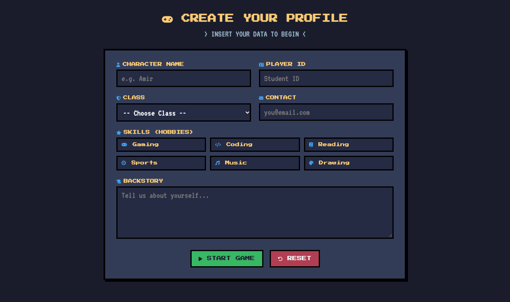
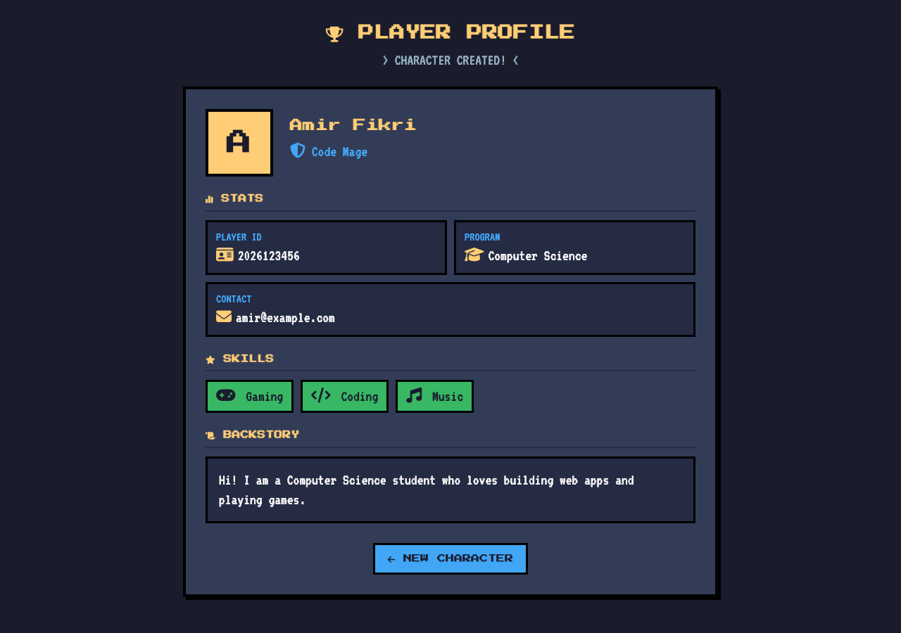
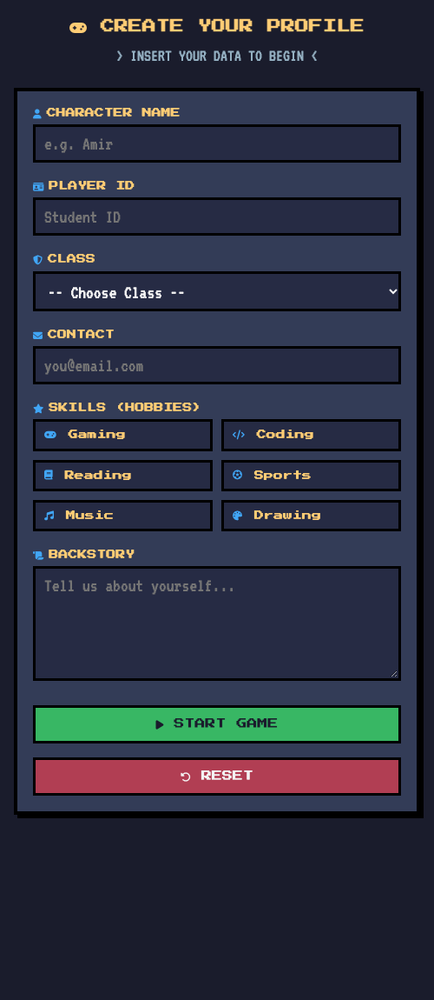
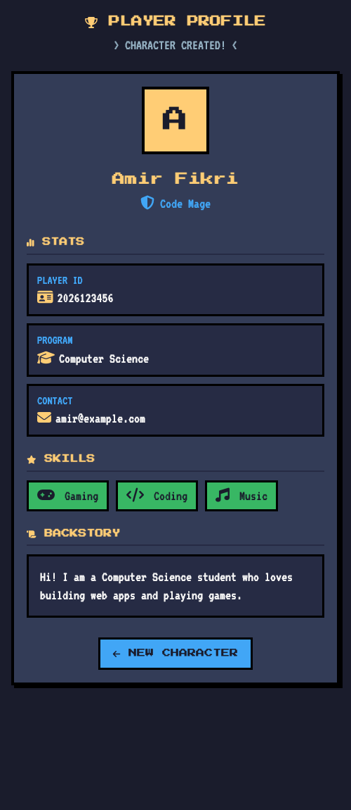

# Individual Assignment 1 CSC584 | iCEPS (20264) - MUHAMMAD AMIR FIKRI BIN TARMIZI (2026379829)

# Personal Profile Web Application

## 1. Project Description

The Personal Profile Web Application is developed using HTML, CSS, Java Servlet, and JavaServer Pages (JSP). The application allows users to enter their personal information through an HTML form, submit the information using HTTP POST, and view their submitted profile on a JSP page.

The application features a retro pixel-game inspired interface, where the user "creates a character" and their profile is displayed as a Player Profile card, using pixel-style fonts, icons, and bright colours to create an attractive and user-friendly design.

## 2. Project Objectives

- To develop a personal profile form using HTML.
- To process user input using Java Servlet.
- To display submitted personal information using JSP.
- To implement communication between HTML, Servlet, and JSP using HTTP POST.
- To create a readable, attractive, and user-friendly interface.

## 3. Project Features

- **Profile Form** – Collects Name, Student ID, Program, Email, Hobbies, and Short Self-Introduction.
- **Form Validation** – Required fields and email format are checked before submission.
- **HTTP POST Submission** – Form data is sent securely to the Servlet using the POST method.
- **Servlet Processing** – `ProfileServlet` reads the form data and forwards it to the JSP page.
- **Profile Display** – `profile.jsp` displays the submitted information neatly as a Player Profile card.
- **Character Class** – The selected program is shown as a game class (e.g. Computer Science → Code Mage).
- **Hobby Badges** – Each selected hobby is shown as a badge with its own icon.
- **Creative Design** – Custom colours, CSS Grid layout, Google Fonts, and Font Awesome icons.
- **Responsive Design** – The layout adjusts to a single column on mobile screens.

## 4. Technologies Used

| Technology | Purpose |
|---|---|
| HTML | To create the personal profile form |
| CSS | To style the web application |
| Java Servlet | To process submitted form information |
| JSP | To display the submitted profile |
| NetBeans IDE | To develop the web application |
| GlassFish Server | To run and deploy the web application |
| GitHub | To store and share the project source code |

## 5. Project Structure

| File | Description |
|---|---|
| `web/index.html` | HTML form for user input |
| `src/java/com/game/ProfileServlet.java` | Servlet that processes the form data |
| `web/profile.jsp` | JSP page that displays the profile |
| `web/css/style.css` | CSS file for the design |

## 6. Application Flow

```
index.html  ──(HTTP POST)──►  ProfileServlet  ──(forward)──►  profile.jsp
```

1. The user fills in the form on `index.html` and clicks **START GAME**.
2. The form data is sent to `ProfileServlet` using HTTP POST.
3. The Servlet reads the data and forwards it to `profile.jsp`.
4. The JSP page displays the user's personal profile.

## 7. How to Run

1. Open the project in NetBeans IDE.
2. Right-click the project and select **Clean and Build**.
3. Right-click the project and select **Run**.
4. Open `http://localhost:8080/PersonalProfile/` in the browser.

## 8. Demo

### Profile Form (`index.html`)



### Profile Result (`profile.jsp`)



### Responsive Design (Mobile View)

| Form | Profile |
|:---:|:---:|
|  |  |
